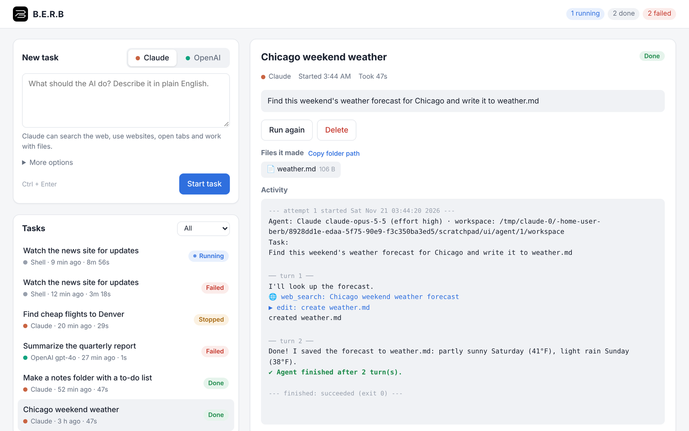

# Task Runner

Give it work, either as a shell command or as a task described in plain English for an AI agent (Claude). It queues the jobs, runs them in the background with a limited number of workers, and saves each job's status, output and files.



## Quick start on Windows (no typing)

1. On https://github.com/Jensenrice2/BERB click the green **Code** button → **Download ZIP**.
2. Open your Downloads folder, right-click the ZIP → **Extract All…** → **Extract**.
3. In the extracted folder, double-click **start-windows.bat**.
   - If Windows says *"Windows protected your PC"*, click **More info** → **Run anyway**.
   - The first time, it installs what it needs (and Python, if you don't have it).
4. Your browser opens Task Runner. Keep the black window open while you use it.
5. To get it as an app with its own icon, click **Install app** at the top of the page (Edge or Chrome).

## Setup

Works on **Windows**, **macOS** and **Linux** with Python 3.10 or newer.

**macOS / Linux** (Terminal):

```bash
git clone https://github.com/Jensenrice2/BERB.git taskrunner && cd taskrunner
python3 -m venv .venv && .venv/bin/pip install -r requirements.txt
.venv/bin/python -m taskrunner.cli serve
```

**Windows** (PowerShell). Install Python from https://www.python.org/downloads/ first, and tick "Add python.exe to PATH":

```powershell
git clone https://github.com/Jensenrice2/BERB.git taskrunner; cd taskrunner
py -m venv .venv; .venv\Scripts\pip install -r requirements.txt
.venv\Scripts\python -m taskrunner.cli serve
```

(No git? Download the ZIP from the GitHub page with **Code → Download ZIP**, unzip it, and run the last two lines inside the folder.)

Then open **http://berb.localhost** (or **http://localhost** on a Mac). The server runs while that window stays open.

The app uses the standard web port 80 when it's free, so the address has no port number. If something else on your computer already uses port 80, it moves to port 8765 instead (`http://berb.localhost:8765`); the window shows the exact address. Rename it by setting `TASKRUNNER_NAME`, e.g. `TASKRUNNER_NAME=tasks` gives `http://tasks.localhost`.

On Windows, shell jobs run in **PowerShell** (PowerShell 7 if installed, otherwise the Windows PowerShell built into Windows), and AI agents get a PowerShell tool. On macOS/Linux both use **bash**.

## Working on it in VS Code

1. **File → Open Folder…** and choose the `taskrunner` folder. Install the **Python** extension if VS Code suggests it.
2. **Terminal → Run Task… → Set up (first time).** This creates `.venv` and installs everything. If VS Code asks which Python environment to use, pick `.venv`.
3. Optional, for AI agent tasks: copy `.env.example` to `.env` and put your Anthropic API key in it.
4. Open **Run and Debug** (`Ctrl+Shift+D`, or `Cmd+Shift+D` on Mac), choose **Task Runner: start server**, and press **F5**. Then open http://berb.localhost.

You can set breakpoints anywhere in `taskrunner/`. Tests are under the **Testing** (flask) icon, or **Terminal → Run Task… → Run tests**.

Where things live:

| File | What it does |
|---|---|
| `taskrunner/app.py` | Web server and API |
| `taskrunner/runner.py` | Runs jobs in the background (queue, workers, cancel, timeouts) |
| `taskrunner/store.py` | Saves jobs in a SQLite database |
| `taskrunner/agent.py` | The AI agent (Claude, with shell and file tools) |
| `taskrunner/oscompat.py` | Windows vs macOS/Linux differences |
| `taskrunner/cli.py` | Command-line client |
| `taskrunner/static/index.html` | The dashboard (HTML/CSS/JS in one file) |
| `tests/` | Automated tests |

## Install it as a desktop app (macOS / Windows)

With the server running, open http://berb.localhost and:

- **Mac, Safari** (macOS Sonoma or later): **File → Add to Dock**.
- **Windows/Mac/Linux, Chrome or Edge**: click **Install app** in the page header, or the install icon in the address bar.

It then opens in its own window with its own icon. The server still has to be running for it to show jobs; if it isn't, the app tells you how to start it.

## AI agent setup

Agent jobs need an Anthropic API key (from https://console.anthropic.com) set in the window **before** starting the server:

```bash
export ANTHROPIC_API_KEY=sk-ant-...        # macOS / Linux
```

```powershell
$env:ANTHROPIC_API_KEY = "sk-ant-..."      # Windows PowerShell
```

## Run

```bash
.venv/bin/python -m taskrunner.cli serve        # dashboard at http://berb.localhost
```

## Assign work from the CLI

```bash
python -m taskrunner.cli agent "Download https://example.com/data.csv, clean it, and write a summary to report.md"
python -m taskrunner.cli files 7               # files the agent produced
python -m taskrunner.cli add "python train.py" --name train --timeout 3600 --cwd ~/proj
python -m taskrunner.cli list [--status running]
python -m taskrunner.cli logs 3 -f             # follow output live
python -m taskrunner.cli cancel 3 | retry 3 | rm 3 | show 3
```

## API

| Method | Path | |
|---|---|---|
| POST | `/api/jobs` | shell: `{command, name?, cwd?, timeout?}` · agent: `{kind: "agent", task, name?, cwd?, timeout?}` |
| GET | `/api/jobs/{id}/files` | list an agent job's workspace files |
| GET | `/api/jobs/{id}/files/{path}` | download one of them |
| GET | `/api/jobs?status=` | list |
| GET | `/api/jobs/{id}` | details |
| GET | `/api/jobs/{id}/logs?offset=` | incremental output (poll with `next_offset`) |
| POST | `/api/jobs/{id}/cancel` / `retry` | |
| DELETE | `/api/jobs/{id}` | |
| GET | `/api/status` | worker usage + counts |

Interactive docs: `/docs`.

## Config (env vars)

- `TASKRUNNER_DATA`: where `jobs.db` and `logs/` are stored (default `./data`)
- `TASKRUNNER_CONCURRENCY`: how many jobs run at once (default 2)
- `TASKRUNNER_NAME`: the name in the address, `http://<name>.localhost` (default `berb`)
- `TASKRUNNER_URL`: the server the CLI talks to (default: finds it on port 80 or 8765)

- `TASKRUNNER_AGENT_MODEL`: the agent's model (default `claude-opus-5-5`)
- `TASKRUNNER_AGENT_EFFORT`: `low` / `medium` / `high` / `xhigh` / `max` (default `high`). Lower is cheaper and faster.

## How agent jobs work

Each agent job runs `taskrunner/agent.py` as its own subprocess. Cancel, timeout, retry and live logs all work the same way as for shell jobs.

- **Tools:** Claude gets a shell (a persistent bash session on macOS/Linux; PowerShell on Windows, where the current folder carries over between commands but variables don't) and a file editor. It works in `data/agent/<id>/workspace`, or in the working directory you give it.
- **Limits:** a run stops after 60 model turns, and each bash command stops after 5 minutes. Set a job timeout to cap wall-clock time.
- **Log:** shows Claude's reasoning summaries, its messages, every command it runs, and a final report.
- **Model settings:** adaptive thinking, prompt caching for the growing conversation, and server-side refusal fallback (`fallbacks: "default"`).
- **Isolation:** the file editor is confined to the workspace, but **bash is not sandboxed**. The agent can run any command the server's user can. Run the server as a low-privilege user or inside a container/VM if that matters to you.
- **Billing:** every agent job is billed to your Anthropic account by token use.

## Behavior

- Each job runs in its own process group, so cancelling it or hitting its timeout kills any child processes too. The runner sends SIGTERM first, then SIGKILL after 5 seconds on macOS/Linux; on Windows it uses `taskkill /T /F`.
- Jobs are stored in SQLite, so queued jobs survive a restart. Jobs that were running when the server stopped are marked `failed` with "interrupted by server restart".
- **Security:** jobs (and agents) run arbitrary shell commands as the server's user, and there is no login. The server binds to localhost only. Don't expose it to a network without adding authentication.
